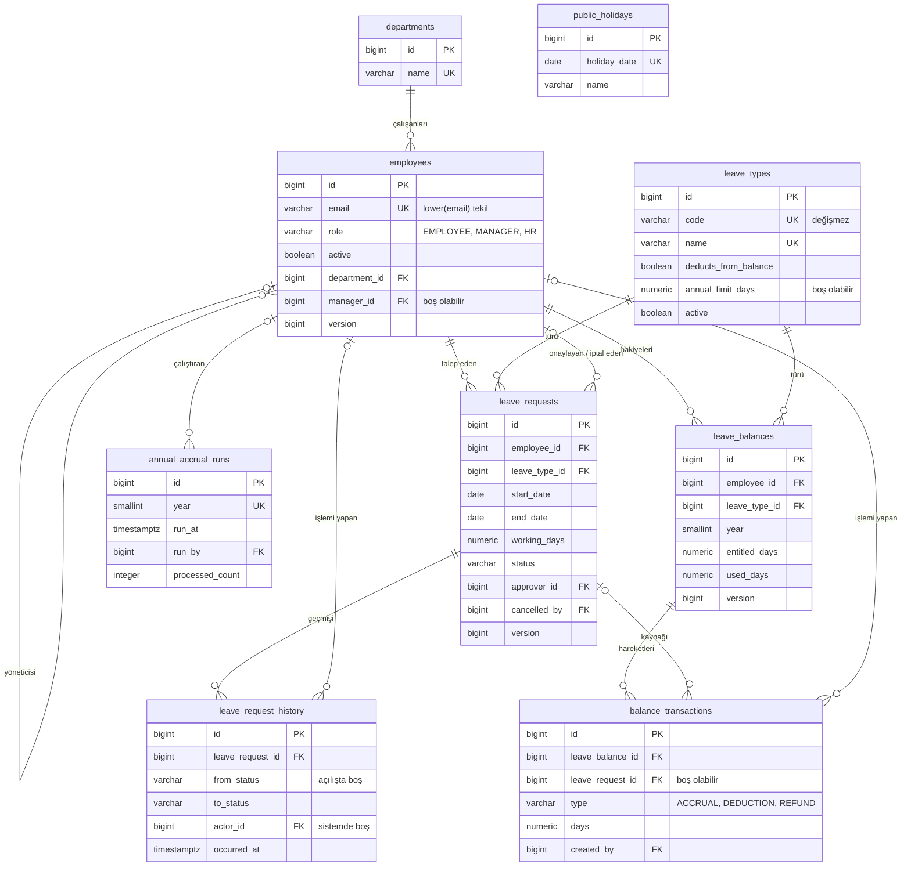

# Veritabanı Tasarımı

Bu doküman Employee Vacation Management veritabanının yapısını, her tablonun hangi iş kuralını koruduğunu,
indekslerin hangi sorgular için var olduğunu ve verinin tutarlı kalması için alınan tasarım kararlarını anlatır.
Scriptlerin çalıştırılma kaydı ve kontrol sorguları [`db/README.md`](../db/README.md)'dedir.

Veritabanı sorumlusu: Zehranur Burmaoğlu.

## İçindekiler

1. [Genel bakış](#1-genel-bakış)
2. [Varlık-ilişki diyagramı](#2-varlık-ilişki-diyagramı)
3. [Tablolar](#3-tablolar)
4. [Kısıtlar ve korudukları kurallar](#4-kısıtlar-ve-korudukları-kurallar)
5. [Sorgu incelemesi ve indeksler](#5-sorgu-incelemesi-ve-indeksler)
6. [Transaction ve eşzamanlılık tasarımı](#6-transaction-ve-eşzamanlılık-tasarımı)
7. [Veri türü ve modelleme kararları](#7-veri-türü-ve-modelleme-kararları)
8. [Uygulamayla eşleme (JPA)](#8-uygulamayla-eşleme-jpa)
9. [Scriptler, ortamlar ve şema değişikliği](#9-scriptler-ortamlar-ve-şema-değişikliği)
10. [Güvenlik](#10-güvenlik)

---

## 1. Genel bakış

| Öğe | Değer |
|---|---|
| Veritabanı | PostgreSQL 17 (Supabase, yönetilen) |
| Şema | `leave_mgmt` (Supabase'in `public` şeması kullanılmaz) |
| Tablo | 9 |
| Kısıt | 9 birincil anahtar, 14 yabancı anahtar, 8 CHECK, 6 UNIQUE |
| İndeks | 21 (kısıtların kendi indeksleri dahil) |
| Testlerde | Aynı scriptlerle kurulan geçici PostgreSQL 17 (Testcontainers, `postgres:17-alpine`) |

Tablolar dört gruba ayrılır:

| Grup | Tablolar | Not |
|---|---|---|
| Organizasyon | `departments`, `employees` | Çalışan silinmez, pasife alınır |
| İzin tanımları | `leave_types`, `public_holidays` | Tür silinmez, pasife alınır; resmi tatiller bonus (FR-38) |
| İzin işlemleri | `leave_requests`, `leave_balances` | Durum ve bakiye değişir; iyimser kilit var |
| Kayıt (yalnızca eklenir) | `leave_request_history`, `balance_transactions`, `annual_accrual_runs` | Güncellenmez ve silinmez; denetim izi |

Hiçbir tabloda satır silme yoktur. Bir çalışan ya da izin türü kullanımdan kalkınca `active = false` olur. Böylece
geçmiş talepler, bakiye hareketleri ve raporlar eski kayıtlara bağlı kalmaya devam eder.

## 2. Varlık-ilişki diyagramı

Bütün tablolarda ayrıca `created_at` ve `updated_at` (`timestamptz`) sütunları vardır; diyagramda gösterilmedi.

## 3. Tablolar

### `departments`
Şirketin departmanları. `name` tekildir (`uq_departments_name`, en fazla 100 karakter).

### `employees`
Çalışanlar ve giriş bilgileri.

| Sütun | Tür | Not |
|---|---|---|
| `first_name`, `last_name` | varchar(50) | |
| `email` | varchar(120) | Büyük/küçük harfe duyarsız tekil: `uq_employees_email_lower` ifade indeksi |
| `password_hash` | varchar(100) | BCrypt; düz şifre hiçbir yerde tutulmaz |
| `hire_date`, `birth_date` | date | Kıdem ve yaşa göre yıllık izin hakkı bunlardan hesaplanır (FR-33) |
| `role` | varchar(20) | `ck_employees_role`: EMPLOYEE, MANAGER, HR |
| `active` | boolean | Pasif çalışan giriş yapamaz, talep açamaz (BR-10) |
| `department_id` | bigint, zorunlu | İK dahil herkes bir departmandadır |
| `manager_id` | bigint, boş olabilir | Kendi tablosuna bağlanır; `ck_employees_not_own_manager` kişinin kendi yöneticisi olmasını engeller |
| `version` | bigint | İyimser kilit |

### `leave_types`
İzin türleri. Seed scripti dört hazır türü yükler (FR-13):

| `code` | Ad | Bakiyeden düşer | Yıllık sınır |
|---|---|---|---|
| ANNUAL | Yıllık izin | evet | boş (kıdem ve yaşa göre hesaplanır) |
| EXCUSE | Mazeret izni | evet | 5 gün |
| SICK | Hastalık izni | hayır | boş |
| UNPAID | Ücretsiz izin | hayır | boş |

`code` ve `name` tekildir. Uygulamada `code` ve `deducts_from_balance` oluşturulduktan sonra değiştirilemez: kod, hak
edişte yıllık iznin anahtarıdır; "bakiyeden düşer mi" sonradan değişirse daha önce düşülmüş bir iznin iadesi yanlış olur.

### `leave_balances`
Bir çalışanın bir izin türündeki yıllık bakiyesi.

- `(employee_id, leave_type_id, year)` tekildir: aynı yıl için ikinci bakiye açılamaz.
- `entitled_days` hak edilen, `used_days` kullanılan gündür. **Kalan gün saklanmaz**, `entitled - used` olarak hesaplanır;
  böylece saklanan iki değer birbiriyle çelişemez.
- `ck_leave_balances_used_days`: kullanılan gün 0'dan küçük ve hak edilenden büyük olamaz. Bakiye negatife düşmez (BR-05)
  kuralının veritabanındaki son savunma hattıdır; uygulama aynı kontrolü önce yapar ve anlaşılır bir hata döner.
- Bakiyeden düşmeyen türler (hastalık, ücretsiz) için bakiye satırı açılmaz.

### `leave_requests`
İzin talepleri ve yaşam döngüleri.

- `status` 7 değerden birini alır (`ck_leave_requests_status`): PENDING, APPROVED, REJECTED, WITHDRAWN, CANCEL_REQUESTED,
  CANCELLED, CANCEL_REQUEST_EXPIRED. Geçişler uygulamadaki durum makinesindedir.
- `ck_leave_requests_dates`: bitiş başlangıçtan önce olamaz. `ck_leave_requests_working_days`: iş günü sıfırdan büyüktür.
- Karar (`approver_id`, `decision_note`, `decided_at`) ve iptal (`cancel_request_*`, `cancelled_by`, `cancel_reason`,
  `cancelled_at`) alanları talebin kendi satırındadır; her geçişin tam kaydı ise `leave_request_history`'dedir.

### `leave_request_history` (yalnızca eklenir)
Bir talebin bir durumdan diğerine her geçişi (BR-16). Talebin açılışı da yazılır; o satırda `from_status` boştur.
`actor_id` gece görevi gibi sistem işlemlerinde boştur. Durum değişikliği ile geçmiş satırı aynı transaction'da yazılır;
geçmiş yazılamazsa durum değişikliği de geri alınır.

### `balance_transactions` (yalnızca eklenir)
Bakiyedeki her değişikliğin kaydı: kim, ne zaman, kaç gün, neden (FR-35).

| `type` | Ne zaman | `leave_request_id` |
|---|---|---|
| ACCRUAL | Yeni çalışan (T4), yıllık hak ediş (T3), önceki yıldan devreden gün (BR-12) | boş |
| DEDUCTION | Onaylanan izin (T1); sonraki yıla devredilen gün (BR-12) | onayda dolu, devirde boş |
| REFUND | İptal edilen iznin iadesi (T2) | dolu |

`ck_balance_transactions_days`: gün her zaman pozitiftir; yönü `type` belirler. Bu yüzden 0 günlük hak edişte (kıdemi
1 yılı doldurmamış çalışanın yıllık izni) bakiye satırı açılır ama hareket yazılmaz. Devir için ayrı bir tür eklenmedi:
mevcut iki tür, notu ("2027 yılına devredildi", "2026 yılından devreden") ile birlikte yeterli ve şema değişikliği gerekmedi.

### `annual_accrual_runs` (yalnızca eklenir)
Yıllık hak edişin hangi yıl için, ne zaman ve kim tarafından çalıştırıldığı. `uq_annual_accrual_runs_year` her yıl için
tek kayda izin verir; "aynı yıl iki kez çalıştırılamaz" kuralı (BR-11) bakiyelere değil bu tabloya bakılarak denetlenir.
Böylece yıl içinde eklenip bakiyesi açılan bir çalışan, o yılın hak edişini yanlışlıkla engellemez.

### `public_holidays`
Resmi tatiller (bonus, FR-38). `holiday_date` tekildir. Uygulama iş günü hesabını bir arayüz üzerinden yapar; tatilleri
dikkate alan uygulama bu tabloyu kullanır (BR-02).

## 4. Kısıtlar ve korudukları kurallar

Kuralların bir kısmı veritabanında da tutulur. Uygulama bir hatayla bu kuralları atlasa bile veri bozulmaz.

| Kısıt | Tablo | Koruduğu kural |
|---|---|---|
| `uq_employees_email_lower` | employees | E-posta büyük/küçük harften bağımsız tekil; giriş bu indeksle yapılır |
| `ck_employees_role` | employees | Yalnızca üç rol |
| `ck_employees_not_own_manager` | employees | Kişi kendi yöneticisi olamaz |
| `uq_leave_types_code`, `uq_leave_types_name` | leave_types | Tür kodu ve adı tekil |
| `uq_leave_balances_employee_type_year` | leave_balances | Bir yıl için tek bakiye |
| `ck_leave_balances_used_days` | leave_balances | Bakiye negatife düşmez, hak edileni aşamaz (BR-05) |
| `ck_leave_requests_dates` | leave_requests | Bitiş başlangıçtan önce olamaz (BR-06'nın bir parçası) |
| `ck_leave_requests_working_days` | leave_requests | İş günü pozitif |
| `ck_leave_requests_status` | leave_requests | Yalnızca tanımlı 7 durum |
| `ck_balance_transactions_type`, `ck_balance_transactions_days` | balance_transactions | Hareket türü ve pozitif gün |
| `uq_public_holidays_date` | public_holidays | Bir güne tek tatil |
| `uq_annual_accrual_runs_year` | annual_accrual_runs | Hak ediş yılda bir kez (BR-11); aynı anda iki çalıştırmayı da durdurur |
| 14 yabancı anahtar | — | Var olmayan çalışana, türe, talebe veya bakiyeye bağlı kayıt olamaz |

Veritabanında tutulmayan kurallar (birden çok satıra ya da tarihe bakan kurallar) uygulamanın Handler ve politika
sınıflarındadır: çakışan talep (FR-17), en az 2 aktif İK (BR-13), mazeret izninin yıllık sınırı (BR-04),
geçmiş tarih ve 30 iş günü sınırı (BR-06), onaylayıcı sırası (BR-07).

## 5. Sorgu incelemesi ve indeksler

### Mevcut indeksler ve kullanan sorgular

| İndeks | Sütunlar | Kullanan sorgu |
|---|---|---|
| `uq_employees_email_lower` | `lower(email)` | Giriş (`findByEmailIgnoreCase`) |
| `uq_leave_types_code` | `code` | Hak edişte yıllık izin türünü bulma |
| `uq_leave_balances_employee_type_year` | `employee_id, leave_type_id, year` | Bakiye görüntüleme (çalışan + yıl, indeksin ilk sütunu), düşüm, iade, bakiye açma |
| `ix_leave_requests_employee_status` | `employee_id, status` | Kendi talepleri; geçmiş aramasında çalışan filtresi |
| `ix_leave_requests_employee_dates` | `employee_id, start_date, end_date` | Çakışan talep kontrolü (FR-17) |
| `ix_leave_requests_approver_status` | `approver_id, status` | Onay bekleyenler listesi (FR-20) |
| `ix_leave_request_history_request` | `leave_request_id` | Bir talebin geçmişi; geçmiş aramasında talebe bağlanma |
| `ix_leave_request_history_occurred_at` | `occurred_at` | Geçmiş aramasında tarih filtresi ve "en yeni önce" sıralaması |
| `uq_annual_accrual_runs_year` | `year` | BR-11 kontrolü |

Diğerleri birincil anahtarların ve tekil kısıtların kendi indeksleridir.

### Sorgu incelemesi (26 Kasım 2026)

Sorgular, gerçek projeden çok büyük bir veriyle (20.000 çalışan, 120.000 bakiye, 100.000 talep, 175.000 geçmiş satırı)
yerel PostgreSQL'de `EXPLAIN ANALYZE` ile ölçüldü:

| Sorgu | Plan | Süre |
|---|---|---|
| Giriş, `upper(email) = upper(?)` (eski hâl) | Tablo taraması (Seq Scan) | 6,4 ms |
| Giriş, `lower(email) = lower(?)` (düzeltilmiş) | Index Scan `uq_employees_email_lower` | 0,07 ms |
| Bakiyeler (çalışan + yıl, izin türüyle birlikte) | Index Scan `uq_leave_balances_employee_type_year` | 0,08 ms |
| Geçmiş araması, çalışan filtresi | `ix_leave_requests_employee_status` + `ix_leave_request_history_request` | 0,3 ms |
| Geçmiş araması, departman filtresi | Index Scan Backward `ix_leave_request_history_occurred_at` | 35 ms |
| Hak edişte aktif çalışanlar | Index Scan birincil anahtar | 5 ms |

Bulunan tek sorun girişteki sorguydu: Spring Data, metot adındaki `IgnoreCase` için `upper()` üretiyordu; indeks ise
`lower()` üzerinde. PostgreSQL bir ifade indeksini yalnızca sorgu aynı ifadeyi kullanırsa kullanabildiği için sorgu elle
`lower()` ile yazıldı. Bir test, sorgunun bu indeksi kullanabildiğini `EXPLAIN` ile denetler.

### Eklenmeyen indeksler

Her indeks her ekleme ve güncellemede ek iş demektir. Bu yüzden indeks yalnızca onu kullanan bir sorgu varsa eklenir:

| Aday | Karar | Gerekçe |
|---|---|---|
| `employees(department_id)` | Eklenmedi | Departman filtreli geçmiş aramasında ölçüldü, fark yaratmadı (35 → 42 ms); planlayıcı yine `occurred_at` indeksini seçti |
| `employees(manager_id)` | Eklenmedi | 20.000 satırda 2,2 ms'yi 0,5 ms'ye indiriyor, ama bu sütunu sorgulayan bir kod yok; ekip takvimi gibi bir sorgu yazılırsa eklenir |
| `balance_transactions` yabancı anahtarları | Eklenmedi | Tablo yalnızca eklenir, okunmaz; bağlı olduğu satırlar silinmediği için yabancı anahtar kontrolü de tarama gerektirmez |

### N+1 sorgusuna karşı önlemler

- `spring.jpa.open-in-view: false`: Controller'da veya JSON'a çevirirken gizli tembel yükleme olamaz; ilişkiye
  transaction dışında erişen kod hemen hata verir.
- Liste sorguları ilişkileri tek sorguda getirir: bakiyeler `join fetch`, geçmiş araması `@EntityGraph` kullanır.
- Testler sorgu sayısını Hibernate Statistics ile ölçer: kendi bakiyelerini görme tam 1 sorgu, geçmiş sayfası en fazla
  2 sorgu (sayfa ve toplam).

## 6. Transaction ve eşzamanlılık tasarımı

### Transaction sınırı
- Her use case'in Handler'ı bir transaction'dır (`@Transactional`). Okuma use case'leri `readOnly = true` kullanır.
- Alan servisleri (`LeaveBalanceService`, `LeaveHistoryService`) kendi transaction'larını açmaz:
  `@Transactional(propagation = MANDATORY)` ile Handler'ınkine katılırlar. Transaction'sız çağrılırlarsa hemen hata
  verirler; böylece bakiye ile talep durumu yanlışlıkla ayrı ayrı kaydedilemez.
- Geçmiş satırı `saveAndFlush` ile hemen yazılır: yazılamazsa hata, durum değişikliği daha kalıcı olmadan çıkar.

### Rollback senaryoları

| Kod | İşlem | Hata olursa |
|---|---|---|
| T1 | İzin onayı: durum, geçmiş, bakiye düşümü | Talep PENDING kalır, geçmiş ve hareket oluşmaz |
| T2 | Onaylı iznin iptali: durum, geçmiş, iade | İzin APPROVED kalır, gün iade edilmez |
| T3 | Yıllık hak ediş: bütün aktif çalışanlar | Hiçbir çalışana hak yazılmaz, çalıştırma kaydı oluşmaz |
| T4 | Çalışan ekleme ve ilk bakiyeler | Çalışan da oluşmaz |
| T5 | Süresi dolan iptal taleplerini kapatma | Her talep kendi transaction'ında; biri hata verirse diğerleri etkilenmez |

T3'ün rollback'i bir testle kanıtlanır: 4 çalışandan 3'üncüsünde hata çıkartılır; ilk ikisinin veritabanına yazılmış
bakiyeleri, hareketleri ve çalıştırma kaydı geri alınır, aynı yıl yeniden çalıştırılabilir.

### Eşzamanlılık
- `employees`, `leave_balances` ve `leave_requests` tablolarında `version` sütunu vardır (iyimser kilit). Aynı satırı
  aynı anda değiştiren ikinci işlem hata alır ve 409 döner; örneğin aynı talep iki kez onaylanamaz (NFR-08), aynı
  bakiyeye iki devir aynı anda yazılamaz.
- Yıllık hak edişte iki İK aynı anda başlatırsa ikisi de "bu yıl çalıştırıldı mı?" kontrolünü geçebilir; ikinci çalıştırma
  kaydını `uq_annual_accrual_runs_year` reddeder ve ikinci işlemin açtığı bütün bakiyeler geri alınır.
- Kullanılmayan iznin devri (BR-12) yalnızca biten yıldan yapılır: yıl bitmeden devredilseydi çalışan aynı günleri
  hem eski yılda kullanabilir hem yeni yıla taşıyabilirdi. Devirde eski yılın hak edilen günü azalır, kullanılan gün
  değişmez; ikinci çalıştırmada devredecek gün kalmadığı için işlem tekrar edilebilir.

## 7. Veri türü ve modelleme kararları

| Karar | Gerekçe |
|---|---|
| Gün sütunları `numeric(4,1)` | Yarım gün izin ve tam ondalık hesap; uygulamada `BigDecimal`. Kayan noktalı sayı (float) yuvarlama hatası yapar |
| Yıl sütunları `smallint` | Değer aralığı küçük; uygulamada `Integer` + `@JdbcTypeCode(SMALLINT)` |
| Zaman sütunları `timestamptz` | Saat dilimiyle saklanır; bağlantı `Europe/Istanbul` ile çalışır |
| Durum ve türler `varchar` + CHECK | PostgreSQL enum türüne göre yeni değer eklemek kolay; Java'da `@Enumerated(STRING)` |
| `bigserial` kimlikler | Kimliği veritabanı verir (`IDENTITY`) |
| Kalan gün saklanmaz | `entitled - used` ile hesaplanır; iki değer çelişemez |
| Silme yok, `active` bayrağı | Geçmiş talepler ve raporlar eski kayıtlara bağlı kalır |
| Yalnızca eklenen kayıt tabloları | Geçmiş, bakiye hareketleri ve hak ediş çalıştırmaları denetim izidir; güncellenmez |
| `annual_accrual_runs` ayrı tablo | BR-11'i bakiyelere bakmadan, tek bir tekil kısıtla korumak |
| `public` yerine `leave_mgmt` şeması | Supabase'in otomatik API'sine açık olan şemadan ayrı durmak (bkz. 10) |

## 8. Uygulamayla eşleme (JPA)

- Her tablonun bir entity'si vardır; ortak `id`, `created_at`, `updated_at` alanları `BaseEntity`'dedir. Zaman
  damgalarını JPA auditing, uygulamanın `Clock`'undan alarak doldurur.
- `spring.jpa.hibernate.ddl-auto: validate`: Hibernate tablo oluşturmaz veya değiştirmez, yalnızca entity'lerin tablolarla
  uyumlu olduğunu açılışta denetler. Şemayı yalnızca scriptler değiştirir.
- İlişkiler tek yönlü `@ManyToOne` ve `LAZY`'dir; `@OneToMany` koleksiyonu yoktur. Bir çalışanın bütün talepleri gibi
  büyüyebilen listeler sayfalı sorgularla okunur.
- Gün, kimlik ve sürüm alanlarının setter'ı yoktur. Bakiyedeki gün yalnızca `LeaveBalance`'ın kendi metotlarıyla
  (`use`, `restore`, devirde `transferOut`/`transferIn`) ve `LeaveBalanceService` üzerinden değişir; her değişiklikle
  birlikte hareket kaydı yazılır.
- Entity eşitliği kimliğe dayanır; kaydedilmemiş iki nesne eşit sayılmaz ve hash kodu kayıttan sonra değişmez.
  Entity'ler kaydedilip geri okunarak her alanın doğru sütuna yazıldığı testlerle denetlenir.

## 9. Scriptler, ortamlar ve şema değişikliği

| Sıra | Dosya | Ne yapar |
|---|---|---|
| 1 | `db/scripts/01_schema.sql` | Şema, 9 tablo, kısıtlar, indeksler |
| 2 | `db/scripts/02_seed_leave_types.sql` | 4 hazır izin türü (FR-13) |
| 3 | `db/scripts/03_security.sql` | 9 tabloda Row Level Security |

| Ortam | Nasıl kurulur |
|---|---|
| Supabase | Scriptler SQL Editor'da sırayla çalıştırıldı (15.11.2026); kayıt `db/README.md`'de |
| Testler | Testcontainers her çalıştırmada temiz bir PostgreSQL 17 açar ve aynı scriptleri çalıştırır. Her test öncesinde tablolar boşaltılır ve seed yeniden yüklenir; testler birbirini etkilemez. H2 gibi bellek içi bir veritabanı kullanılmaz, çünkü kısıtlar ve SQL davranışı PostgreSQL'e özgüdür |

Kurallar:
- Çalıştırılmış bir script değiştirilmez; her şema değişikliği yeni numaralı bir scripttir (`04_...sql`) ve entity
  değişikliğiyle aynı PR'da gelir.
- Scriptler tekrar çalıştırılabilir (`if not exists`, `on conflict do nothing`) ve her biri tek transaction'dır.
- Supabase'de tablo değiştiren komutu yalnızca veritabanı sorumlusu çalıştırır.

## 10. Güvenlik

- Uygulama veritabanına JDBC ile, SSL zorunlu (`sslmode=require`) bağlanır. Bağlantı bilgileri ve şifre koda yazılmaz,
  ortam değişkenlerinden okunur (`DB_URL`, `DB_USERNAME`, `DB_PASSWORD`).
- Supabase'in Data API'si kapatılamadığı için `leave_mgmt` şeması bu API'ye açılmadı. Ayrıca 9 tabloda Row Level Security
  açıktır ve politika tanımlanmamıştır: Data API rolleri hiçbir satırı göremez. Uygulama tabloların sahibi olan
  kullanıcıyla bağlandığı için RLS'ten etkilenmez.
- Şifreler yalnızca BCrypt özeti olarak saklanır.
